<div align="center">

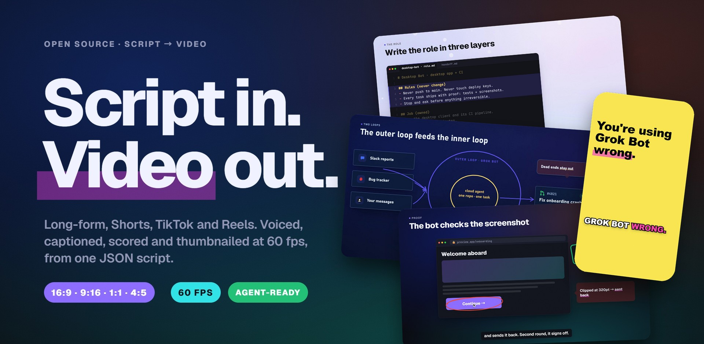

# TrueSight Motion Kit

**Turn a JSON script into a finished 60 fps video, with voice, music, captions, thumbnails and publish copy.**<br>
It makes YouTube long-form, Shorts, TikTok and Reels on a deterministic renderer, with every animation timed to a spoken word.

[](LICENSE)
[](#one-script-every-format)
[](#how-it-works)
[](#built-for-ai-agents)
[](https://nodejs.org)
[](https://www.python.org)
[](https://github.com/tamseno/truesight-kit/stargazers)

[Quick start](#quick-start) · [How it works](#how-it-works) · [Gallery](#gallery) · [Docs](docs/README.md) · [Playbook](docs/PLAYBOOK.md) · [中文](README.zh-CN.md)

</div>

<br>

<table>
<tr>
<td width="76%" valign="top">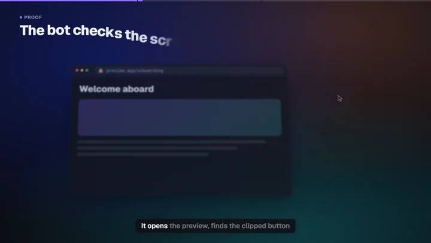<br><sub><b>Long-form, 16:9.</b> The bot checks a screenshot, circles the bug and stamps it verified, each step landing on its word.</sub></td>
<td width="24%" valign="top">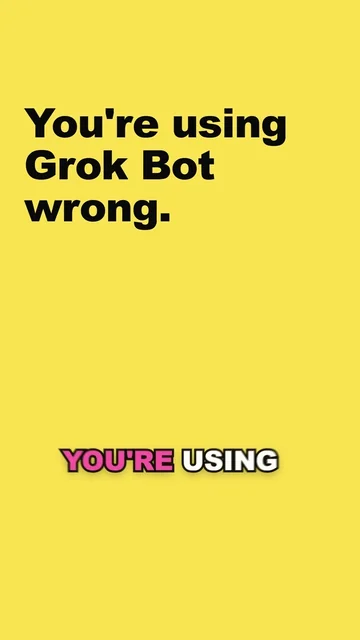<br><sub><b>Short, 9:16.</b> The hook is on screen from frame 0, captions pop word by word, and nothing sits under the app's buttons.</sub></td>
</tr>
</table>

## Why TrueSight

Most code-driven video tools hand you a timeline editor written in code. TrueSight works more like a **director with a crew**.
You write what the viewer should *hear* and what they should *see*. The kit times every move to the narration, lays it out
for the platform, renders it frame-perfect, and then checks its own work before you publish.

- **A library, not a template.** It has 7 looks, 51 elements, 66 motions, 17 layouts, 25 ready-made scenes and 108 icons. Episodes compose their own pictures, and a variety check stops two videos from looking alike.
- **One script, every format.** Layouts reflow from 16:9 to 9:16, and elements scale up for phones. Short-form gets pop captions and stays clear of platform UI.
- **Synced to the voice.** Word timings come from the real narration (IndexTTS voice clone + faster-whisper). `"in": "rise@proof"` means the element arrives the moment *proof* is said.
- **Checks its own work.** Lint, phone-legibility, safe-zone and contrast QA, dead-air detection, and a finished-video review run before anything ships (frozen frames, blank frames, −14 LUFS, true peak).
- **Ready to ship.** Output is H.264/HEVC with BT.709 tags, plus word-timed SRT captions, three thumbnail variants and a publish sheet with title, description, chapters, sources and hashtags.
- **Built for volume.** A batch queue overlaps voice synthesis with rendering, one command scaffolds a Short from a long video, and the music library is original and license-free.
- **Made for AI agents.** It ships `AGENTS.md`, a playbook with a check at every step, a front-door CLI that always prints the next command, and an Agent Skill for Claude Code, Codex and Cursor.

## Quick start

> Requires **Node 20+**, **Python 3.11+** and **Google Chrome**. An NVIDIA GPU speeds up encoding but is optional: software x264/x265 is used automatically.

```bash
git clone https://github.com/tamseno/truesight-kit && cd truesight-kit
npm install                                            # puppeteer-core, driving your installed Chrome
python -m venv .venv && .venv/Scripts/pip install -r requirements.txt     # macOS/Linux: .venv/bin/pip
cp kit.config.example.json kit.config.json             # Chrome path; optional voice-clone + aligner envs
python tools/ts.py doctor                              # is this machine ready?
```

Make your first Short:

```bash
python tools/ts.py new my-first-short --format vertical   # from the Short template
python tools/make.py episodes/my-first-short draft        # stills + every check, in seconds
python tools/make.py episodes/my-first-short final        # the MP4, captions, thumbnails, publish sheet
python tools/ts.py next my-first-short                    # where it stands and what to run next
```

Without a voice clone configured, finals use the free edge-tts voice, so everything works out of the box.

## Write this, get this

A scene is plain JSON. You decide what appears and **on which word**, and the kit handles layout, motion, camera, sound and captions.

<table>
<tr>
<td width="46%" valign="top">

```json
{
  "type": "compose", "theme": "paper",
  "label": "The numbers", "title": "Where the money comes from",
  "lines": ["Last quarter, revenue grew twelve percent.",
            "Search still brings almost half of it."],
  "data": { "layout": "split", "els": [
    { "el": "kpi", "slot": "left", "in": "rise@revenue",
      "label": "Quarterly revenue", "value": 84200,
      "prefix": "$", "delta": "+12%", "spark": [3,4,3.5,5,6,7] },
    { "el": "pie", "slot": "right", "in": "fade@Search",
      "items": [{ "label": "Search", "value": 46 },
                { "label": "Social", "value": 27 },
                { "label": "Direct", "value": 18 },
                { "label": "Other",  "value": 9 }] }
  ] }
}
```

</td>
<td width="54%" valign="top">
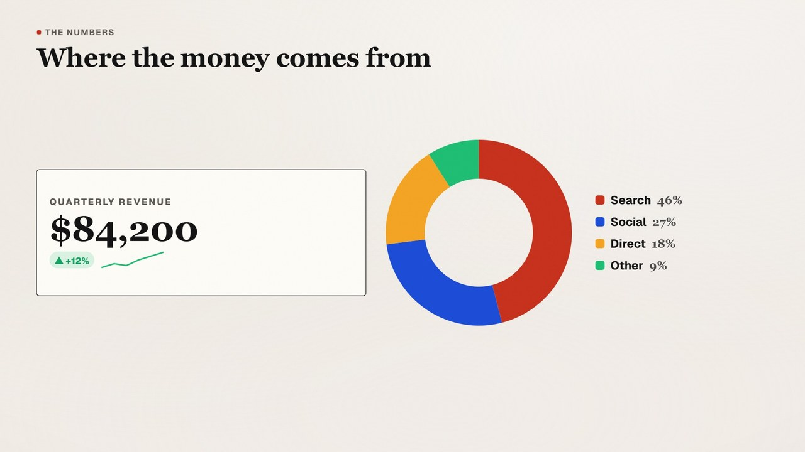
<sub>The value counts up as "revenue" is spoken, the sparkline draws, and the pie sweeps in on "Search". The same scene in a 9:16 Short stacks the two slots vertically with no changes.</sub>
</td>
</tr>
</table>

## Gallery

<p align="center">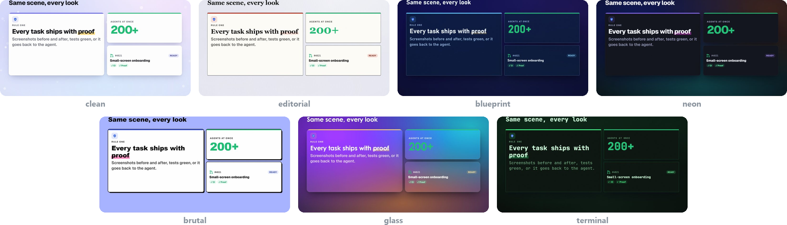<br><sub><b>Seven looks, one scene.</b> Clean, editorial, blueprint, neon, brutal, glass and terminal. A look sets type, palette, surfaces, motion feel and default transition.</sub></p>

<h3 id="one-script-every-format">One script, every format</h3>
<p align="center">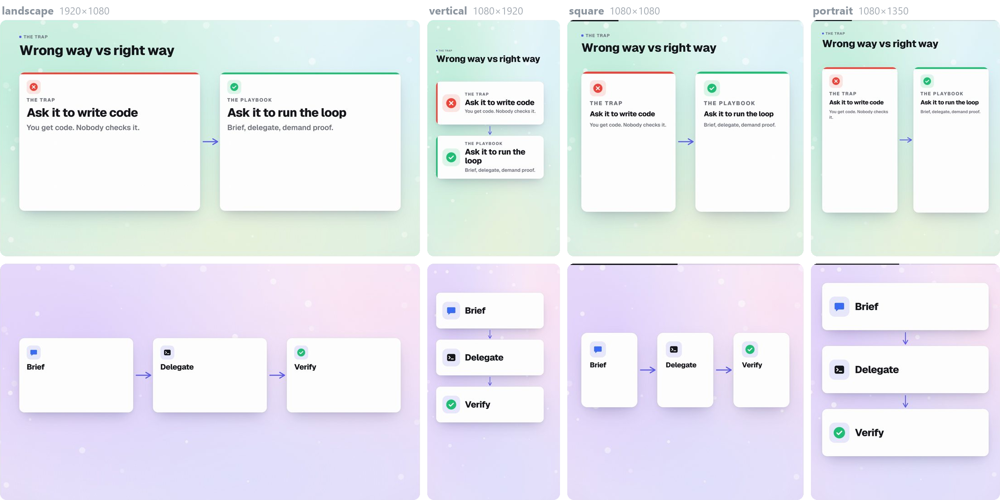<br><sub>Landscape 1920×1080 · vertical 1080×1920 · square 1080×1080 · portrait 1080×1350. Layouts reflow, and elements scale up for phones.</sub></p>

<details>
<summary><b>More: elements, motions, layouts, icons</b></summary>
<br>
<p align="center">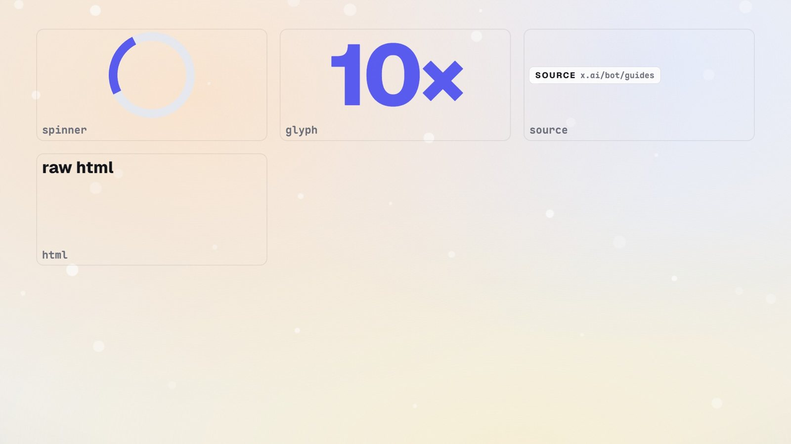</p>
<p align="center">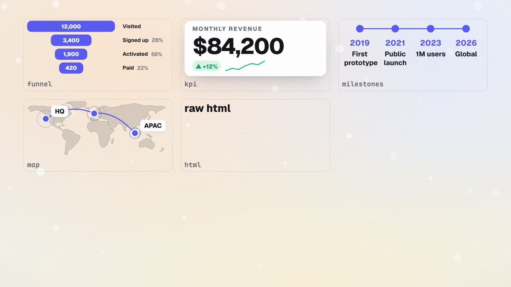</p>
<p align="center">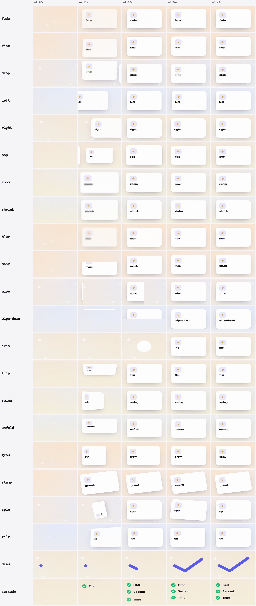</p>
<p align="center">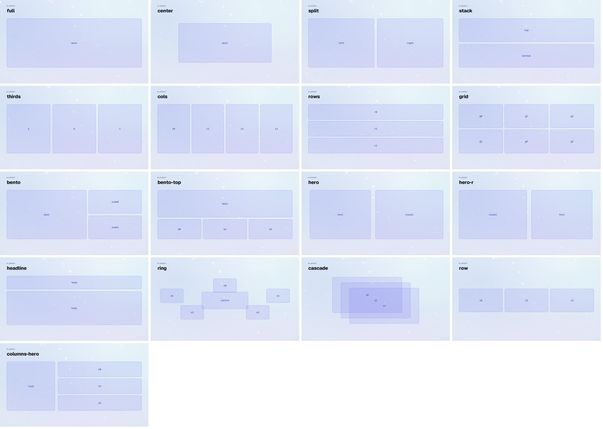</p>
<p align="center">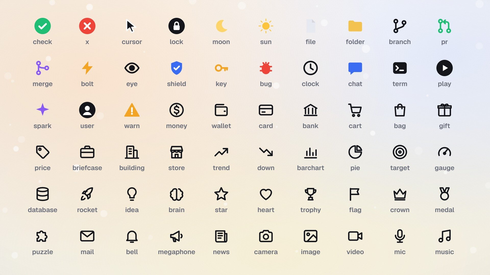</p>

Every item, with props and a working example, is listed in [`docs/CATALOG.md`](docs/CATALOG.md).
</details>

## How it works

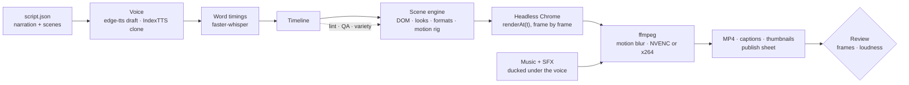

- **Deterministic.** The engine exposes `renderAt(t)`: any frame renders identically on any worker, so dozens of Chrome pages render in parallel and an interrupted render resumes where it stopped.
- **The browser is the canvas.** Real typography, CSS, SVG and web fonts. Elements are small factories, motions compose as poses on a shared rig, and looks are design tokens.
- **Timed by speech.** Every `@phrase` cue resolves against whole spoken words in the aligned narration, so a pacing change in the voice moves the animation with it.

## The toolbox

| Command | What it does |
|---|---|
| `python tools/ts.py next <ep>` | Where an episode stands, what's wrong, and the exact next command |
| `python tools/ts.py new / status / guide / doctor` | Start from a template · every episode's stage · the playbook · machine check |
| `python tools/make.py <ep> draft\|preview\|voice\|final\|all` | The pipeline; `final` also writes chapters, review, thumbnails and the publish sheet |
| `python tools/batch.py all --ready --pipeline` | Every episode marked `ready`, with voice and render overlapped; `--quiet` for nights |
| `python tools/cutdown.py <long> <new>` | Scaffold a Short from a long video's strongest scenes |
| `python tools/ingest.py rec.mp4 <ep> demo` | Screen recording → frame-accurate `clip` element |
| `node tools/shot.mjs url=… out=… full=1` | Web page screenshot, scrollable with the image `pan` |
| `python tools/bgm.py --list` | The generated music library: 10 moods × 3 tracks |
| `node tools/render.mjs ep=… look=neon scenes=s03 at=.9` | Preview any scene in another look without editing |

## Built for AI agents

The workflow is written once and every agent reads it.

- [`AGENTS.md`](AGENTS.md) is the rules, read by Codex, Cursor, Copilot, Gemini and others. `CLAUDE.md` and `GEMINI.md` point to it.
- [`docs/PLAYBOOK.md`](docs/PLAYBOOK.md) goes from topic to published video, with a check at every step.
- `python tools/ts.py next <episode>` is the loop an agent runs until it says `done`.
- The **`truesight-video` skill** lives in `.agents/skills/` (mirrored to `.claude/skills/`). `python tools/ts.py install-skill` makes it available in any folder.

> *"Use truesight-video to make a 40-second Short about why AI agents need proof, in the brutal look."*

## Performance

Measured on a Ryzen 9 9950X3D (32 threads) with an RTX 5080 and 24 Chrome workers:

| Job | Frames | Render | Notes |
|---|---:|---:|---|
| 42 s Short, final, 1080×1920 | 10,128 | 53 s | 4 sub-frames per frame for motion blur |
| 8 min long-form, preview, 1920×1080 | 28,671 | 2 min 18 s | about 208 frames/s |
| Draft of any episode | 2 per scene | 2–5 s | stills, lint, QA and variety |

## Project layout

```text
core/
  engine.js         timeline, camera, transitions, captions, QA
  looks.js          7 looks as design tokens
  formats.js        4 canvases + safe zones
  lib/              elements, motions, layouts, icons, catalog
  archetypes/       compose + 25 ready-made scenes
tools/              ts · make · batch · render · timeline · voice · align · mix · review · thumb · publish · cutdown · ingest · shot · bgm
episodes/           one folder per video: script.json (+ media/); _template and _template-short to start from
docs/               PLAYBOOK · AGENT · CATALOG · ARCHITECTURE · DESIGN (中文) · gallery/
.agents/skills/     the truesight-video skill (mirrored in .claude/skills/)
```

## Documentation

| Read | When |
|---|---|
| [Playbook](docs/PLAYBOOK.md) | You're making a video, from topic to upload |
| [Scene guide](docs/AGENT.md) | You're writing scenes that should look designed, not templated |
| [Catalog](docs/CATALOG.md) + [gallery](docs/gallery/) | You want to know what exists: every look, element, motion and layout |
| [Architecture](docs/ARCHITECTURE.md) | You're changing the engine or adding an element |
| [设计说明 (中文)](docs/DESIGN.md) | 中文概览 |

## Roadmap

- [ ] Preset voice packs and a CPU-only voice path
- [ ] Narration in Chinese and other languages end to end, including captions and fonts
- [ ] Cloud rendering: split one episode across machines
- [ ] Thumbnail A/B export straight to YouTube
- [ ] More looks, plus community element packs

## Contributing

Issues and pull requests are welcome; see [CONTRIBUTING.md](CONTRIBUTING.md). New elements, motions and looks are the easiest
places to start, and the gallery shows what you've built automatically.

## License and credits

[MIT](LICENSE) © 2026 Ezra Tam / TrueSight AI.

Built on [Puppeteer](https://pptr.dev), [FFmpeg](https://ffmpeg.org), [IndexTTS](https://github.com/index-tts/index-tts),
[faster-whisper](https://github.com/SYSTRAN/faster-whisper) and [edge-tts](https://github.com/rany2/edge-tts). Bundled fonts
[Geist](https://vercel.com/font), [Maple Mono](https://github.com/subframe7536/maple-font) and
[Noto Sans SC](https://fonts.google.com/noto/specimen/Noto+Sans+SC) are licensed under the SIL Open Font License.
Background music is generated by `tools/bgm.py`.
