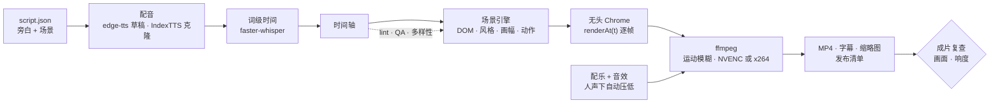

<div align="center">


# TrueSight Motion Kit

**写一份 JSON 脚本，出一条 60 fps 的成片，配音、配乐、字幕、缩略图和发布文案一起生成。**<br>
横屏长视频、YouTube Shorts、TikTok、Reels 都能做；渲染是确定性的，每个动画都对准旁白里的一个词。

[](LICENSE)
[](#一份脚本所有画幅)
[](#工作原理)
[](#为-ai-agent-而建)
[](https://github.com/tamseno/truesight-kit/stargazers)

[快速开始](#快速开始) · [工作原理](#工作原理) · [样片](#样片) · [文档](docs/README.md) · [出片流程](docs/PLAYBOOK.md) · [English](README.md)

</div>

<br>

<table>
<tr>
<td width="76%" valign="top"><br><sub><b>横屏长视频 16:9。</b> bot 检查截图、圈出问题、盖章通过，每一步都落在说出来的那个词上。</sub></td>
<td width="24%" valign="top"><br><sub><b>竖屏 Short 9:16。</b> 第 0 帧就是钩子，字幕逐词弹出，内容都避开了 App 的按钮区。</sub></td>
</tr>
</table>

## 为什么是 TrueSight

大多数"用代码做视频"的工具，给你的是一个写成代码的剪辑时间轴。TrueSight 更像**一位导演带着一组团队**：
你只管写观众会**听到**什么、会**看到**什么；它把每个动作对准旁白，按平台排版，逐帧精确渲染，发布前再自己检查一遍。

- **是素材库，不是模板。** 7 种风格、51 个元素、66 种动作、17 种布局、25 个现成场景、108 个图标；每期自己拼画面，多样性检查会防止两期做成一个样。
- **一份脚本，所有画幅。** 布局从 16:9 自动重排到 9:16，元素在手机上自动放大；短视频用逐词弹出的大字幕，并避开平台界面。
- **跟着声音走。** 词级时间来自真实配音（IndexTTS 声音克隆 + faster-whisper 对齐）；`"in": "rise@proof"` 表示说到 *proof* 的那一刻元素出现。
- **自己检查自己。** 发布前自动跑 lint、手机可读性 / 安全区 / 对比度检查、画面停滞检测，以及成片复查（静止画面、黑帧、−14 LUFS 响度、峰值）。
- **拿来就能发。** H.264/HEVC 带 BT.709 色彩标记，另有逐词计时的 SRT 字幕、三张缩略图备选，以及含标题、简介、章节、来源和话题标签的发布清单。
- **为量产而建。** 批量队列让下一期配音和这一期渲染同时进行；一条命令从长视频生成 Short 草稿；配乐是原创生成的，没有版权问题。
- **为 AI agent 而建。** 自带 `AGENTS.md`、每步都有检查点的出片流程、永远告诉你下一条命令的命令行入口，以及可在 Claude Code、Codex、Cursor 里使用的 Agent Skill。

## 快速开始

> 需要 **Node 20+**、**Python 3.11+** 和 **Google Chrome**。有 NVIDIA 显卡会编码更快；没有也行，会自动改用软件编码（x264/x265）。

```bash
git clone https://github.com/tamseno/truesight-kit && cd truesight-kit
npm install                                            # puppeteer-core，调用你已安装的 Chrome
python -m venv .venv && .venv/Scripts/pip install -r requirements.txt     # macOS/Linux：.venv/bin/pip
cp kit.config.example.json kit.config.json             # 填 Chrome 路径；声音克隆和对齐环境可选
python tools/ts.py doctor                              # 检查这台机器能不能出片
```

做第一条 Short：

```bash
python tools/ts.py new my-first-short --format vertical   # 从短视频模板新建
python tools/make.py episodes/my-first-short draft        # 几秒内出截图并跑完全部检查
python tools/make.py episodes/my-first-short final        # 出成片、字幕、缩略图和发布清单
python tools/ts.py next my-first-short                    # 现在到哪一步、下一步跑什么
```

没有配置声音克隆时，成片会用免费的 edge-tts 配音，拉下代码就能完整跑通。

## 写这些，得到这个

一个场景就是一段普通的 JSON。你决定出现什么、**在哪个词上**出现；排版、动作、镜头、音效和字幕都交给它。

<table>
<tr>
<td width="46%" valign="top">

```json
{
  "type": "compose", "theme": "paper",
  "label": "The numbers", "title": "Where the money comes from",
  "lines": ["Last quarter, revenue grew twelve percent.",
            "Search still brings almost half of it."],
  "data": { "layout": "split", "els": [
    { "el": "kpi", "slot": "left", "in": "rise@revenue",
      "label": "Quarterly revenue", "value": 84200,
      "prefix": "$", "delta": "+12%", "spark": [3,4,3.5,5,6,7] },
    { "el": "pie", "slot": "right", "in": "fade@Search",
      "items": [{ "label": "Search", "value": 46 },
                { "label": "Social", "value": 27 },
                { "label": "Direct", "value": 18 },
                { "label": "Other",  "value": 9 }] }
  ] }
}
```

</td>
<td width="54%" valign="top">

<sub>说到 "revenue" 时数字开始累加、折线画出来，说到 "Search" 时饼图扫出。同一个场景放进 9:16 的 Short，左右两栏会自动改成上下排列，一行都不用改。</sub>
</td>
</tr>
</table>

## 样片

<p align="center"><br><sub><b>同一个场景，七种风格。</b> clean、editorial、blueprint、neon、brutal、glass、terminal。风格决定字体、配色、卡片质感、动效节奏和默认转场。</sub></p>

<h3 id="一份脚本所有画幅">一份脚本，所有画幅</h3>
<p align="center"><br><sub>横屏 1920×1080 · 竖屏 1080×1920 · 方屏 1080×1080 · 4:5 1080×1350。布局自动重排，元素在手机上自动放大。</sub></p>

<details>
<summary><b>更多：元素、动作、布局、图标</b></summary>
<br>
<p align="center"></p>
<p align="center"></p>
<p align="center"></p>
<p align="center"></p>
<p align="center"></p>

每一项的参数和可直接运行的示例都在 [`docs/CATALOG.md`](docs/CATALOG.md)。
</details>

## 工作原理



- **确定性。** 引擎提供 `renderAt(t)`，同一时刻在任何进程里渲染出的画面都一样；所以可以几十个 Chrome 页面并行渲染，中断了也能接着渲染。
- **浏览器就是画布。** 真正的排版、CSS、SVG 和网页字体。元素是小工厂函数，动作以姿态的形式叠加在同一个元件上，风格就是一组设计变量。
- **由语音驱动时间。** 每个 `@短语` 卡点都按完整单词匹配对齐后的旁白；配音节奏一变，动画也跟着变。

## 工具箱

| 命令 | 作用 |
|---|---|
| `python tools/ts.py next <剧集>` | 这一期在哪一步、有什么问题、下一条该跑的命令 |
| `python tools/ts.py new / status / guide / doctor` | 从模板新建 · 所有剧集的进度 · 出片流程 · 机器检查 |
| `python tools/make.py <剧集> draft\|preview\|voice\|final\|all` | 出片流程；`final` 会顺带生成章节、成片复查、缩略图和发布清单 |
| `python tools/batch.py all --ready --pipeline` | 把所有标记为 ready 的剧集排队出片，配音和渲染同时进行；晚上加 `--quiet` |
| `python tools/cutdown.py <长视频> <新剧集>` | 从长视频挑最有冲击力的场景，生成 Short 草稿 |
| `python tools/ingest.py rec.mp4 <剧集> demo` | 录屏 → 逐帧同步播放的 `clip` 元素 |
| `node tools/shot.mjs url=… out=… full=1` | 网页截图，可配合图片的 `pan` 在画面里滚动 |
| `python tools/bgm.py --list` | 生成的配乐库：10 种情绪 × 3 首 |
| `node tools/render.mjs ep=… look=neon scenes=s03 at=.9` | 不改脚本，直接预览某个场景换成另一种风格的样子 |

## 为 AI agent 而建

流程只写一份，所有 agent 都读它：

- [`AGENTS.md`](AGENTS.md) 是规则，Codex、Cursor、Copilot、Gemini 等都会读；`CLAUDE.md`、`GEMINI.md` 只是指向它。
- [`docs/PLAYBOOK.md`](docs/PLAYBOOK.md) 从选题到发布，每一步都有检查点。
- `python tools/ts.py next <剧集>` 是 agent 循环执行的命令，直到它显示 `done`。
- **`truesight-video` skill** 在 `.agents/skills/`（`.claude/skills/` 里是同一份）；`python tools/ts.py install-skill` 可以装到全局，在任何文件夹都能用。

> *"用 truesight-video 做一条 40 秒的 Short，讲为什么 AI agent 需要交付证据，用 brutal 风格。"*

## 性能

在 Ryzen 9 9950X3D（32 线程）、RTX 5080、24 个 Chrome 渲染进程上实测：

| 任务 | 帧数 | 渲染耗时 | 说明 |
|---|---:|---:|---|
| 42 秒 Short 正式版，1080×1920 | 10,128 | 53 秒 | 每帧 4 张子帧做运动模糊 |
| 8 分钟长视频预览，1920×1080 | 28,671 | 2 分 18 秒 | 约每秒 208 帧 |
| 任意一期的 draft | 每场景 2 张 | 2–5 秒 | 截图、lint、QA、多样性检查 |

## 目录结构

```text
core/
  engine.js         时间轴、镜头、转场、字幕、QA
  looks.js          7 种风格（设计变量）
  formats.js        4 种画布 + 平台安全区
  lib/              元素、动作、布局、图标、素材目录
  archetypes/       compose + 25 个现成场景
tools/              ts · make · batch · render · timeline · voice · align · mix · review · thumb · publish · cutdown · ingest · shot · bgm
episodes/           每条视频一个文件夹：script.json（+ media/）；从 _template / _template-short 开始
docs/               PLAYBOOK · AGENT · CATALOG · ARCHITECTURE · DESIGN（中文）· gallery/
.agents/skills/     truesight-video skill（.claude/skills/ 里是同一份）
```

## 文档

| 文档 | 什么时候看 |
|---|---|
| [出片流程](docs/PLAYBOOK.md) | 要做一条视频，从选题到上传 |
| [场景指南](docs/AGENT.md) | 要写出像精心设计、而不是套模板的场景 |
| [素材目录](docs/CATALOG.md) + [样片](docs/gallery/) | 想知道有哪些风格、元素、动作、布局 |
| [架构说明](docs/ARCHITECTURE.md) | 要改引擎或新增元素 |
| [设计说明](docs/DESIGN.md) | 中文概览 |

## 路线图

- [ ] 预置声音包，以及不需要显卡的配音方案
- [ ] 中文等多语言旁白全流程（含字幕与字体）
- [ ] 云端分布式渲染：一期拆到多台机器
- [ ] 缩略图 A/B 测试直连 YouTube
- [ ] 更多风格，以及社区元素包

## 参与贡献

欢迎提 Issue 和 PR，见 [CONTRIBUTING.md](CONTRIBUTING.md)。最容易上手的是新增元素、动作和风格，样片集会自动把你做的东西展示出来。

## 许可与致谢

[MIT](LICENSE) © 2026 Ezra Tam / TrueSight AI。

基于 [Puppeteer](https://pptr.dev)、[FFmpeg](https://ffmpeg.org)、[IndexTTS](https://github.com/index-tts/index-tts)、
[faster-whisper](https://github.com/SYSTRAN/faster-whisper)、[edge-tts](https://github.com/rany2/edge-tts)。
随附字体 [Geist](https://vercel.com/font)、[Maple Mono](https://github.com/subframe7536/maple-font)、
[Noto Sans SC](https://fonts.google.com/noto/specimen/Noto+Sans+SC) 均采用 SIL Open Font License；配乐由 `tools/bgm.py` 生成。
